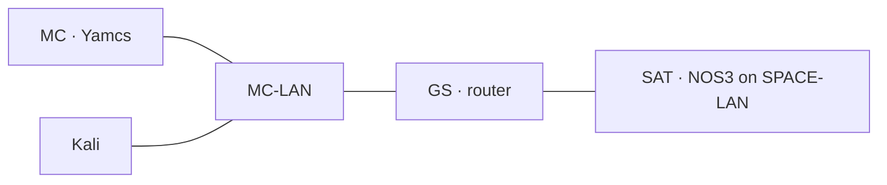

# CCSDS Satellite Cybersecurity Lab

This lab uses Yamcs at mission control and NOS3 with cFS on a simulated satellite. A gateway routes traffic between two VirtualBox internal networks. The same radio path carries clear or SDLS-protected telemetry and telecommands.

## Architecture

| VM | Role | Lab interface | Address |
| --- | --- | --- | --- |
| mc | Mission control (Yamcs) | eth1 on MC-LAN | 192.168.10.20 |
| gs | Ground gateway | eth1 on MC-LAN | 192.168.10.30 |
| gs | Ground gateway | eth2 on SPACE-LAN | 192.168.20.30 |
| sat | Satellite (NOS3) | enp0s8 on SPACE-LAN | 192.168.20.10 |
| kali | Scenario workstation | eth1 on MC-LAN | 192.168.10.40 |



Mission control sends telecommands to UDP 8010 on SAT. The radio simulator forwards them to cFS. Radio telemetry returns through GS to UDP 6011 on MC. The simulation also sends truth data to UDP 5111 on MC. The NAT adapter on each VM provides package and source downloads.

## First installation

Use a Linux host with Git, Vagrant, VirtualBox, OpenSSH and Python 3. The host-side mode tool needs POSIX file locking. For WSL2, check Vagrant and VirtualBox integration before provisioning.

```bash
git clone https://github.com/BaptisteBemel/satellite_lab_cybersecurity.git
cd satellite_lab_cybersecurity
```

Check the pinned Yamcs revision in `provision/mc/YAMCS_REVISION.txt`. If the Yamcs fork lacks that commit, restore the local `provision/mc/yamcs-history.bundle` before provisioning MC. SAT generates the separate `nos3-components.tar.gz` archive consumed by MC.

Run from the project root:

```bash
vagrant up gs && vagrant up sat && vagrant up mc
```

On **freshly provisioned VMs**, prepare a new SDLS key pair, build the first FSW with that pair and start the simulator containers. Wait for the headless launcher to finish before selecting the reference mode.

```bash
vagrant ssh mc -c 'bash /vagrant/scripts/sdls/generate_keys.sh' &&
bash scripts/sdls/distribute_keys.sh &&
vagrant ssh sat -c 'python3 /vagrant/scripts/sdls/build_fsw_with_keys.py' &&
vagrant ssh sat -c 'sudo systemctl start nos3-headless.service' &&
python3 scripts/lab-mode.py clear
```

## Running lab

Open Yamcs at `http://127.0.0.1:8090` on the host. Run `python3 scripts/lab-mode.py status` to inspect the session and `python3 scripts/lab-mode.py check` to sample radio telemetry and 42. Use `python3 scripts/lab-mode.py sdls` or `clear` to start a fresh session. Start Kali separately with `vagrant up kali` when the scenario calls for it. See the [mode guide](profiles/README.md) for startup checks, session keys and recovery.

| Scenario | Required profile | Machines |
| --- | --- | --- |
| [00 — Baseline communication](scenarios/00-baseline/README.md) | clear for scenario 01, sdls for a protected reference | MC, GS, SAT |
| [01 — Attacker on the mission-control network](scenarios/01-attacker-on-mission-control-network/README.md) | clear | MC, GS, SAT, Kali |

Run `bash verification.sh --baseline` to check core connectivity, the Yamcs API, radio packet arrival and a legitimate No-Op event onboard. Run it while other operators are idle to correlate the event with its submission. With no arguments it also checks Kali. Keep the active profile, UTC time window and evidence for each run under `captures/<scenario>/`.

## Repository

- `Vagrantfile` and `provision/` define and build the guests.
- `profiles/` contains the clear and SDLS configurations.
- `scripts/` contains mode selection, its guest operations and key management.
- `tests/` contains the local tests and pinned fixtures. Run `python3 tests/test_lab_modes.py` with Git and a C compiler installed. PyYAML enables the YAML structure test.
- `scenarios/` contains one directory per scenario and the shared observation helpers. For a new scenario, document its mode and add it to the table above.

## Troubleshooting

For failed downloads, check name resolution on the affected VM with `getent hosts github.com` and inspect the provisioner output. On SAT, `docker system df` shows disk usage. For a failed mode switch, inspect `.lab-mode/last.json` and the build log named by the mode tool.
